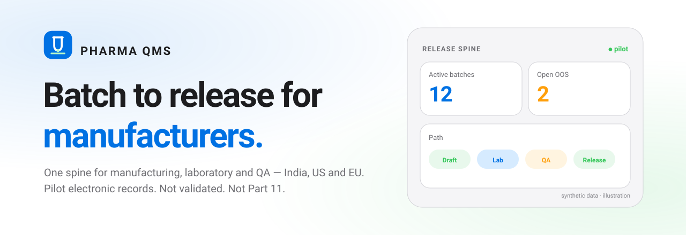
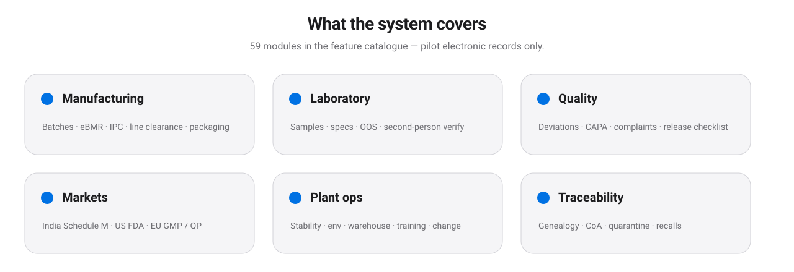
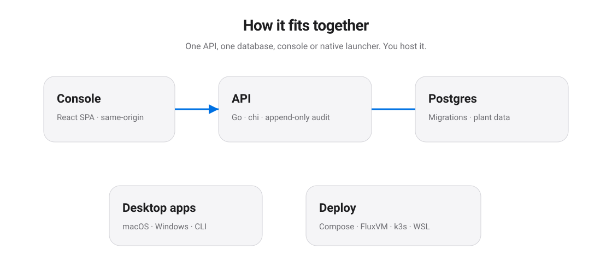
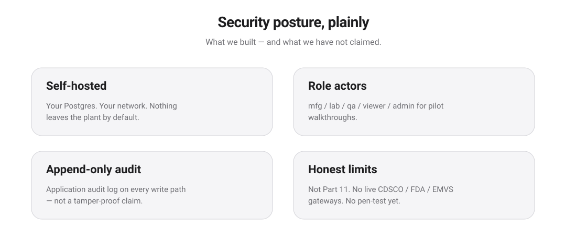

<div align="center">

<picture>
  <source media="(prefers-color-scheme: dark)" srcset="assets/banner-dark.svg">
  
</picture>

<p>
  
  
  
  
  
  
</p>

<p>
  <a href="https://zyvorai.github.io/zyvor-pharma-qms-site/"></a>
  <a href="https://pharma.zyvor.dev"></a>
  <a href="https://zyvorai.github.io/zyvor-pharma-qms-site/try/"></a>
  <a href="docs/README.md"></a>
  <a href="resources/PharmaQMS-Executive-overview.pdf"></a>
</p>

### Batch to release for manufacturers.

**One spine for manufacturing, laboratory and QA** — with India Schedule M, US FDA and EU GMP market modules.

<sub>Batches · guided eBMR · IPC · Laboratory · OOS · Second-person verify · Deviations · CAPA · Release · Genealogy · Stability · Warehouse · Suppliers · Workflows · APQR / APR / PQR · PV · QP · Serialization · GDP · Licences · Schedule M checklist</sub>

</div>

> [!IMPORTANT]
> **Zyvor Pharma QMS is pilot-ready software, not a validated / Part 11 system.** Use synthetic or non-regulated demonstration data only. Do not use for regulated release decisions without your own validation. Distinct from retail [Zyvora Pharmacy](https://zyvorai.github.io/zyvor-pharma-site/).

This repository is the **public product website**, one-line installers and printable PDFs. There is **no application source code** here. The product repository is private.

---

## Live demo

**[pharma.zyvor.dev](https://pharma.zyvor.dev)** is a shared, read-only demo on synthetic data (details and sign-in on the [Try it](https://zyvorai.github.io/zyvor-pharma-qms-site/try/#live) page). It may be reset or changed at any time and is not for real data.

## What it covers

The product's feature catalogue (release v0.1.0) lists **84 entries: 73 modules plus 11 propose-only AI assistants**. Pilot and partial entries (passkeys, SAML, SCIM, connectors, approval workflows, offline queue, partial site scoping) are flagged as such in the catalogue.

<picture>
  <source media="(prefers-color-scheme: dark)" srcset="assets/capabilities-dark.svg">
  
</picture>

Every module in plain words: **[Modules](https://zyvorai.github.io/zyvor-pharma-qms-site/modules/)** · markets matrix: **[Markets](https://zyvorai.github.io/zyvor-pharma-qms-site/markets/)**.

## Try it on your computer

Native **macOS** (`PharmaQMS.app`) and **Windows** (`PharmaQMS.exe`) launchers, or one install command. Postgres + API + console on your machine. Nothing leaves your laptop.

> [!NOTE]
> The installer scripts expect release bundles on this repository's Releases page. **None are published yet**, so the commands below do not work today. Evaluation bundles are available on request (sales@zyvor.dev).

```bash
# Mac or Linux — for when a site release publishes the install bundle
curl -fsSL https://github.com/zyvorai/zyvor-pharma-qms-site/releases/latest/download/get.sh | sh -s -- up
```

```powershell
# Windows PowerShell
& ([scriptblock]::Create((irm https://github.com/zyvorai/zyvor-pharma-qms-site/releases/latest/download/get.ps1))) up
```

Full walkthrough: **[Try it](https://zyvorai.github.io/zyvor-pharma-qms-site/try/)**. The product source is private.

---

## How it fits together

<picture>
  <source media="(prefers-color-scheme: dark)" srcset="assets/architecture-dark.svg">
  
</picture>

## Security and honest limits

<picture>
  <source media="(prefers-color-scheme: dark)" srcset="assets/security-dark.svg">
  
</picture>

| We built | We do not claim |
|---|---|
| Self-hosted Postgres + Go API | Validated / Part 11 / Annex 11 certification |
| Argon2id + TOTP + passkeys, OIDC / SAML SSO, SCIM (strict mode, operator-enabled) | Validated / Part 11 / Annex 11; the default dev mode trusts identity headers |
| Hash-chained application audit with review by exception | Cryptographic WORM / independent pen-test (an AI-assisted review is not an independent audit) |
| Partial site scoping, SSRF guard, login throttling | Role checks on every write endpoint |
| India / US / EU **electronic-record** modules | Live CDSCO / FDA ESG / EMVS gateways |
| Desktop + compose + k3s + FluxVM paths | GST / e-invoice tax engine (wrong product) |

**[Intended use](docs/INTENDED-USE.md)** · **[Security page](https://zyvorai.github.io/zyvor-pharma-qms-site/security/)**

---

## Take it to your team (PDFs)

| Sheet | File |
|---|---|
| Executive overview | [PharmaQMS-Executive-overview.pdf](resources/PharmaQMS-Executive-overview.pdf) |
| Pilot guide | [PharmaQMS-Pilot-guide.pdf](resources/PharmaQMS-Pilot-guide.pdf) |
| Module guide | [PharmaQMS-Module-guide.pdf](resources/PharmaQMS-Module-guide.pdf) |
| Markets India · US · EU | [PharmaQMS-Markets-India-US-EU.pdf](resources/PharmaQMS-Markets-India-US-EU.pdf) |
| Security & honest limits | [PharmaQMS-Security-and-honest-limits.pdf](resources/PharmaQMS-Security-and-honest-limits.pdf) |
| Architecture & deployment | [PharmaQMS-Architecture-and-deployment.pdf](resources/PharmaQMS-Architecture-and-deployment.pdf) |
| IT & security questions | [PharmaQMS-IT-and-security-questions.pdf](resources/PharmaQMS-IT-and-security-questions.pdf) |

Rebuild: `python3 scripts/gen-graphics.py && ./scripts/render-social.sh && node scripts/build-pdfs.mjs`

---

## Social / Open Graph

| Asset | Use |
|---|---|
| [assets/og.png](assets/og.png) | Link previews (1200×630) |
| [docs/assets/social-preview.png](docs/assets/social-preview.png) | Docs / GitHub social |
| [assets/banner-light.svg](assets/banner-light.svg) / [banner-dark.svg](assets/banner-dark.svg) | README hero |

---

## Contact

sales@zyvor.dev · security@zyvor.dev

## License

Copyright © 2026 ZyvorAI Labs Private Limited. See [LICENSE](LICENSE). Website content only; no application source is published here.
